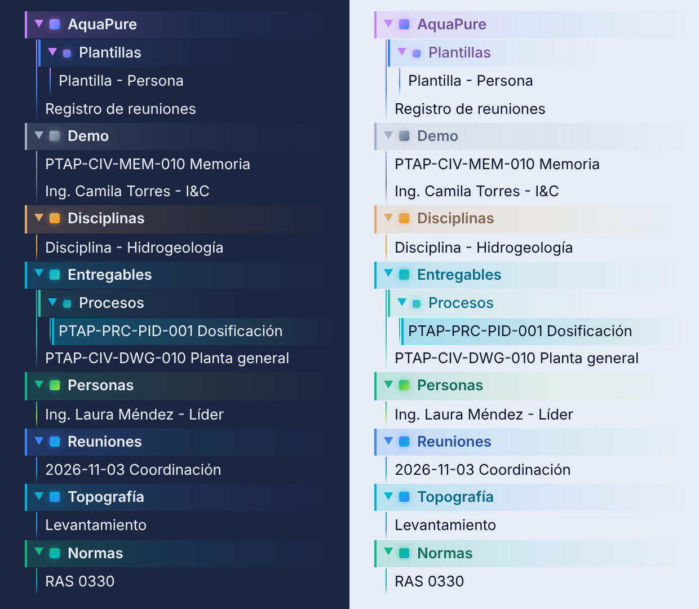

# 💧 AquaPure: Potable Water Engineering Coordinator

**Plugin de Obsidian + tema "PureWater SCADA Blueprint"** que convierte tu Vault en una cabina de control EPC para la ingeniería de **Plantas de Tratamiento de Agua Potable (PTAP)**: matriz de disciplinas, gestión del cambio con revisiones por impacto, balance de carga del equipo y gamificación "Clean Flow".

100 % local: lee y escribe solo en tu Vault mediante `MetadataCache` y `Vault API`. Sin servidores ni telemetría.

<p align="center">
  <a href="https://buymeacoffee.com/SSebas09hd"></a>
  
  
</p>

---

## 📘 Guía de uso

**¿Primera vez?** Lee la **[Guía de uso completa](docs/GUIA.md)**: primeros pasos en 10 minutos, conceptos, flujo diario, reuniones, plantillas, tren de tratamiento y solución de problemas.

La misma guía viene **dentro del plugin**: se abre sola la primera vez y luego con el botón **? Guía** del dashboard, los **?** de cada panel (te llevan a la sección correspondiente) o el comando *AquaPure: Abrir guía de uso*.

### En 5 pasos
1. **Ajusta el tren** de tratamiento: Dashboard → *Editar tren* (convencional, filtración directa, FiME, compacta o a la medida).
2. **Registra al equipo**: **+ Persona** (la disciplina decide a quién llegan los impactos).
3. **Crea los entregables**: **+ Entregable** (código automático, impactos, dependencias y firmas).
4. **Registra reuniones**: **+ Reunión**. Las acciones con responsable entran a su carga.
5. **Trabaja desde el dashboard**: emite revisiones, firma, despeja impactos y cierra pendientes con botones.

> **Regla de oro:** crea con formularios y cambia con botones. Así el historial, las firmas y los impactos quedan consistentes sin escribir YAML.

## Qué hace

| Módulo | Función |
|---|---|
| **Semáforo del tren** | Captación → mezcla rápida → floculación → sedimentación → filtración → desinfección → almacenamiento. Verde = todo IFC, ámbar = en ingeniería, rojo pulsante = bloqueo o vencido. Sello de calidad al completar una etapa sin cuellos de botella. |
| **Matriz disciplina × estado** | Conteo interactivo de entregables por disciplina y estado (Borrador, En Revisión, Aprobado c/ Com., IFC, Bloqueo). Clic en una celda para listar y abrir los documentos. |
| **Gestión del cambio (MOC)** | Cuando un entregable cambia de revisión o de estado (ej. `Rev A - Revisión Interna` → `Rev B - Aprobado con Comentarios`), genera **revisiones pendientes por impacto** para cada disciplina de `impacts:` y para cada documento que declare `depends_on:` hacia él, asignadas a las personas de esa disciplina. |
| **Carga de trabajo** | Suma entregables asignados, tareas en línea `- [ ]` que enlazan a la persona e impactos abiertos, contra su `capacity_hours`. Indicador Baja / Óptima / Sobrecarga con umbrales configurables. |
| **Clean Flow** | XP técnica, racha Cero Rework, Velocity de aprobación y 5 niveles de madurez de la PTAP. |
| **Tren editable** | Etapas configurables por proyecto (renombrar, reordenar, agregar, quitar), con configuraciones típicas: convencional, filtración directa, FiME, planta compacta, convencional + lodos. |
| **Pendientes** | Todas las casillas `- [ ]` de entregables y actas en un panel y una vista con filtros (disciplina, responsable, vencidas). Responsable por enlace en la línea (o heredado del entregable) y fecha con `📅 AAAA-MM-DD`. Se cierran desde el dashboard. |
| **Disciplinas dinámicas** | 6 disciplinas base + cualquier nota con `type: discipline` o un `discipline: <Nueva>` desconocido se registra sola, sin reiniciar. |

## Sin YAML a mano (v1.1)

| Acción | Dónde |
|---|---|
| **+ Persona, + Disciplina, + Entregable, + Reunión** | Barra del dashboard y paleta de comandos. Formularios con desplegables y chips que leen el equipo, las disciplinas y los entregables existentes. |
| **Código automático** | El formulario de entregable numera solo: `PTAP-PRC-PID-002` según los que ya existen (el prefijo `PTAP` se cambia en ajustes). |
| **Emitir revisión** | Botón en cada entregable del dashboard, clic derecho sobre la nota o comando. Sugiere la siguiente revisión (A→B…, 0 desde IFC), guarda historial en `revision_history`, reinicia firmas y dispara las revisiones por impacto. |
| **Firmar** | Panel *Firmas pendientes* o clic derecho. |
| **Reuniones** | Formulario de acta con asistentes, entregables tratados, decisiones y acciones con responsable y fecha. Las acciones entran a la carga de esa persona. |
| **Registro de reuniones** | `AquaPure/Registro de reuniones.md` se recompila solo: acciones abiertas por responsable (con vencidas), registro de decisiones e índice cronológico. |
| **Plantillas editables** | `AquaPure/Plantillas/` (persona, disciplina, entregable, reunión). Edita el cuerpo y los formularios lo usarán; el frontmatter siempre lo genera el plugin con `stringifyYaml` / `processFrontMatter`. |
| **Barra de estado** | Impactos abiertos, vencidos y XP; clic para abrir el dashboard. |

## Modelo de datos (frontmatter)

### Persona
```yaml
type: stakeholder
name: Ing. Laura Méndez
role: Líder            # Ingeniero / Revisor / Líder
discipline: [Procesos]
capacity_hours: 40
```
Toda tarea abierta en la nota de la persona cuenta como su carga; en otras notas, una tarea cuenta si enlaza a la persona en la misma línea: `- [ ] Validar cota Parshall [[Ing. Andrés Rojas - Civil]]`.

### Entregable
```yaml
type: deliverable
code: PTAP-PRC-PID-001
title: P&ID Dosificación de Coagulante y Floculación
doc_type: P&ID                 # PFD, Plano, Memoria de Cálculo, Hoja de Datos, Especificación…
discipline: Procesos           # o se deduce del código PTAP-PRC-…
stage: [mezcla_rapida, floculacion]
phase: Detalle
revision: A
status: Rev A - Revisión Interna
impacts: ["Civil", "Mecánica", "I&C"]
depends_on: ["[[PTAP-PRC-PFD-001 Diagrama de Flujo de Proceso]]"]
assigned_to: "[[Ing. Laura Méndez - Líder de Procesos]]"
due: 2026-11-20
effort_hours: 16
critical: false                # true = memoria / instrumentación crítica (+80 XP al aprobarse)
major_comments: 0              # > 0 al emitir IFC reinicia la racha Cero Rework
required_signatures: ["[[Ing. Laura Méndez - Líder de Procesos]]"]
signatures: []
```
Estados reconocidos (texto libre, sin tildes ni mayúsculas obligatorias): *revisión / review / IFR* → En Revisión · *aprobado / approved* → Aprobado · *IFC / para construcción / as-built* → IFC · *bloqueo / crítico / hold / rechazado* → Bloqueo.

### Disciplina nueva
```yaml
type: discipline
name: Operación y Mantenimiento
color: "#c084fc"
```

## Gamificación Clean Flow

| Evento | XP |
|---|---|
| Despejar una revisión por impacto antes de su plazo (`impactSlaDays`) | **+60** |
| Memoria de cálculo / hoja de datos / entregable `critical: true` pasa a Aprobado o IFC | **+80** |
| Todas las revisiones por impacto de una revisión cerradas **y** todas las `required_signatures` presentes | **+120** |

Cada premio tiene una clave única (documento + revisión), así que no se duplica al re-escanear.

**Niveles de madurez** (calculados del estado real del Vault):
1. Caracterización y Tren Conceptual
2. Ingeniería Básica Consolidada: ≥ 5 de 7 etapas cubiertas y ≥ 30 % aprobado
3. Ingeniería de Detalle Coordinada: ≥ 60 % aprobado y 0 bloqueos
4. Construcción (IFC) sin Interferencias: ≥ 90 % IFC y 0 impactos abiertos
5. Puesta en Marcha / Agua Tratada Cumpliendo Norma: lo anterior + `water_quality_compliant: true` en el acta de arranque

Todo el progreso vive en `data.json` del plugin; se exporta con el comando **Exportar estadísticas Clean Flow** y se reinicia desde los ajustes.

## Instalación

### Manual (recomendada mientras no esté en el directorio oficial)
1. Descarga `main.js`, `manifest.json` y `styles.css` de la última [Release](../../releases).
2. Cópialos en `<tu-vault>/.obsidian/plugins/aqua-pure-coordinator/`.
3. Obsidian → Ajustes → Complementos de la comunidad → activa **AquaPure**.
4. Tema opcional (incluye explorador de carpetas en degradado: las carpetas del plugin tienen color propio y las subcarpetas heredan el de su carpeta madre): copia la carpeta `theme/PureWater SCADA Blueprint/` en `<tu-vault>/.obsidian/themes/` y selecciónalo en Ajustes → Apariencia.

### Desde el código
```bash
git clone https://github.com/SSebas09hd/obsidian-aqua-coordinator.git
cd obsidian-aqua-coordinator
npm install
npm run build        # genera main.js (tsc estricto + esbuild)
```

Las notas de `examples/` son un mini-proyecto PTAP listo para copiar al Vault y probar el disparador de cambios: abre el P&ID `PTAP-PRC-PID-001` y cambia `revision: A` → `B`.

## Tema PureWater SCADA Blueprint

<p align="center"></p>

- **Carpetas con color semántico:** Entregables (cian → esmeralda), Personas (verde), Reuniones (cobalto), Disciplinas (ocre), AquaPure (violeta → cobalto).
- **Resto de carpetas:** paleta cíclica de 6 degradados del tema; subcarpetas y archivos heredan la familia de color de su rama.
- **Archivo activo y hover** con el degradado de su carpeta.
- ¿Prefieres un explorador neutro? Activa un snippet CSS (Ajustes → Apariencia → Fragmentos CSS) con:
  `.nav-folder-title, .nav-file-title { background: none !important; border-left: none !important; } .nav-folder-title-content::before { display: none !important; }`

## Comandos

- Abrir guía de uso · Abrir pendientes de entregables · Editar tren de tratamiento
- Nuevo miembro del equipo · Nueva disciplina · Nuevo entregable · Registrar reunión
- Emitir nueva revisión · Firmar un entregable · Compilar registro de reuniones · Crear / restaurar plantillas
- Abrir Dashboard del Coordinador PTAP
- Re-escanear Vault
- Exportar estadísticas Clean Flow (JSON)
- Regenerar expedientes de impacto por disciplina (notas propias del plugin en `AquaPure/Expedientes/`, opcional)

## Arquitectura

```
main.ts                         Ciclo de vida, eventos del Vault, persistencia diferida
settings.ts                     AquaPureSettingTab
core/VaultIndex.ts              Índice incremental desde MetadataCache (sin leer archivos)
core/DisciplineRegistry.ts      Disciplinas base + auto-descubiertas
core/CoordinatorEngine.ts       MOC / Impact Tasks, semáforo, matriz, carga
core/Gamification.ts            XP idempotente, racha, madurez, velocity
core/DossierWriter.ts           Expedientes por disciplina (solo archivos propios)
core/NoteFactory.ts             Creación de notas, códigos, revisiones y firmas
core/MeetingCompiler.ts         Registro de reuniones, decisiones y acciones
ui/modals.ts                    Formularios (persona, disciplina, entregable, reunión, revisión, firma)
ui/TrainEditorModal.ts          Editor del tren de tratamiento
ui/guideContent.ts              Contenido de la guía (fuente única → vista Guía y docs/GUIA.md)
core/stages.ts                  Tren activo y configuraciones típicas
core/TaskCollector.ts           Pendientes de entregables y actas
views/PendingTasksView.ts       Vista de pendientes con filtros
views/GuideView.ts              Guía integrada
views/PtapCoordinatorDashboardView.ts
styles.css                      Estilos .aquapure-* (oscuro SCADA / claro plano técnico)
theme/PureWater SCADA Blueprint Tema companion para toda la interfaz
```

Rendimiento: el índice se construye una vez desde la caché de metadatos y luego se actualiza **archivo por archivo** con debounce (400 ms); el dashboard se re-renderiza como máximo ~3 veces por segundo y `data.json` se guarda en lotes de 1 s. El plugin nunca reescribe tus notas.

## Apoya el proyecto

Si AquaPure te ahorra horas de coordinación, puedes invitarme un café ☕

<a href="https://buymeacoffee.com/SSebas09hd"></a>

## Autor y licencia

Creado por **Juan Sebastián Herrera Delgado** ([@SSebas09hd](https://github.com/SSebas09hd)), ingeniero civil especialista en infraestructura hidráulica.

Distribuido bajo licencia [MIT](LICENSE) © 2026 Juan Sebastián Herrera Delgado. Puedes usar, modificar y redistribuir el código conservando el aviso de copyright.
